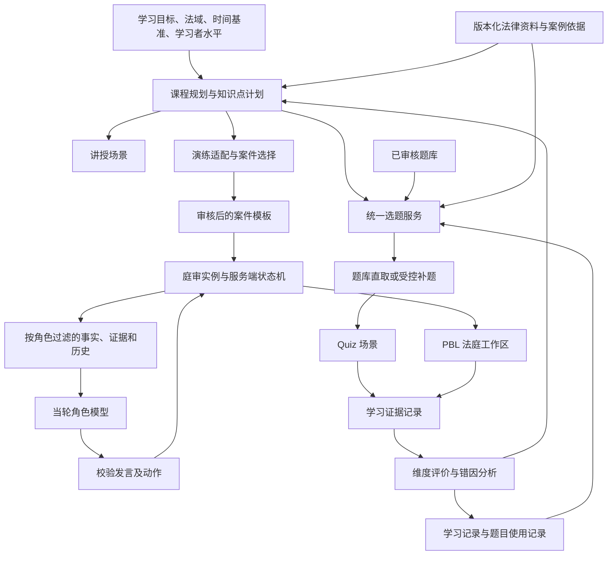

# OpenMAIC 法学垂直化架构审查与设计建议

审查日期：2026-10-30。参考源码：`D:/project/OpenMAIC-main`，package.json 标记版本为 1.2.0-rc.1。

范围：扫描仓库业务目录与文件分布，沿课程生成、Pro 工具、题目渲染与评分、PBL 规划与模拟、课堂调度、持久化链路阅读关键实现。排除依赖、构建产物及二进制资源；不是对全部文件逐行审计，也未启动真实模型进行端到端性能验证。下文明确区分已存在能力和拟新增设计。参考项目未修改。

## 1. 设计结论

建议定位为“有依据的法学讲授、测评与实战训练”，建设四个相连的模块：法律知识与版本管理、受控题库、案件演练、学习证据与反馈。题库和法庭都应关联同一知识点体系，否则容易成为三个互不相通的产品：讲课、刷题、聊天。

第一版建议以中国大陆法学教学、民事合同争议、单人扮演一方诉讼代理人为工作假设。具体受众（本科、法考、实务培训）、法域、课程范围仍需产品决策。这一假设不意味着刑事、行政和其他法域可以套用同一套程序。

技术路线：保留 Stage → Scene → Content + Actions；题库做服务端领域服务；模拟法庭复用 PBL 入口、工作区和评价外壳，但新增服务端权威状态机及角色信息隔离；Skill 描述教学策略，MCP 作为未来跨系统调用的可选适配层。

## 2. 已核对的代码事实

以下路径相对参考仓库根目录。

| 现有模块与文件 | 已存在的实现 | 对本方案的意义 |
|---|---|---|
| `lib/server/generation/run/plan.ts`、`engine.ts` | 经典课程按资料、检索、大纲、角色、逐页 content/actions/narration 执行；检查点和事件持久化 | 在内容生成阶段插入题库服务；保存选题结果以保证重试不换题 |
| `lib/server/generation/steps/scene-content.ts` | 经典内容生成服务端入口 | 经典 quiz 分支需执行强制选题策略 |
| `packages/@openmaic/generation/src/scene-generator.ts`，约 855 行 | `generateQuizContent` 由大纲构造提示词，直接调用模型生成题目，再做格式归一化与校验 | 当前这条链路没有题库优先逻辑；格式合法不等于法律答案正确 |
| `lib/server/agent-runtime/generation-tools.ts`，约 421 行 | Pro 工具直接调用 generation 包生成页面 | 只改经典入口会漏掉 Pro 新建和重生成 |
| `components/stage/scene-renderer.tsx` | 正常课堂 quiz 使用 `QuizView`；PBL 使用 `PBLRenderer` | 不应误改旧的简单 quiz-renderer 作为唯一入口 |
| `components/scene-renderers/quiz-view.tsx` | 选择题本地判分、简答题调用 API，尝试记录进入 RuntimeStore | 支持练习；严格考试要另建服务端答题投影与评分入口 |
| `app/api/quiz-grade/route.ts` | 接收题干、答案、分值、可选评分提示；模型结果解析失败回退到 50% 分数 | 法学评价应改为可信题目版本和评分规则；失败应显示待评，不能伪造半分 |
| `packages/@openmaic/dsl/src/pbl.ts` | 已有 scenario、characters、milestones、microtasks、documents、successWhen 等 | 可复用案件准备、演练、复盘的结构 |
| `lib/pbl/v2/agents/planner.ts` | 大纲中的 `pblConfig.scenarioRoleplay` 启用情境角色扮演规划 | 可以规划课程中的演练位置，但不应临时随意生成决定案件结果的事实 |
| `lib/pbl/v2/agents/simulator.ts` | 角色设定集中构造；`speakingCharacter` 返回首个角色；多角色时提示模型选择一个自然回应的角色 | 不等同于有独立知识权限和程序控制的多方庭审系统 |
| `app/api/pbl/v2/simulator/route.ts` | 请求携带完整 project，服务端据此驱动模拟 | 严格庭审应改为 sessionId + command，由服务端加载可信案件和权限 |
| `lib/pbl/v2/agents/instructor-memory.ts` | 导师线程超过 30 条压缩，保留近期约 16 条，摘要上限 4500 字符 | 可借鉴，但庭审须保留可引用的原始发言与证据事件 |
| `lib/pbl/v2/agents/simulator.ts`，约 52 行 | Simulator 保留最多 300 条历史，没有专门摘要压缩 | 长庭审存在上下文和延迟风险，不能假设所有 Agent 已自动解决 |
| `lib/pbl/v2/runtime/document-persistence.ts` | 将 PBL 设计模板与学习者运行数据分开 | 案件模板和每次庭审实例也应分开保存 |
| `packages/@openmaic/storage/src/runtime/pg.ts` | Runtime 会话按 stage 和 learner 隔离，记录运行数据 | 可复用底层设施，但领域命令、权限和事务仍需新增 |
| `lib/chat/pi/director-loop.ts` | 课堂讨论由 Director 调度；与 PBL Simulator 是不同链路 | 不应把普通课堂 Director 当作现成庭审裁判 |
| `lib/server/agent-runtime/skills.ts`、`skills/agent-runtime/` | Pro 运行时存在 Skill 加载和教学策略资料 | 法学 Skill 能指导规划，不能替代题库强制策略与业务事务 |
| `package.json` 与源码搜索 | 声明 MCP SDK 依赖，但在已搜索业务目录未找到通用 MCP 连接、工具发现和调用主链路 | 不能据依赖包判断“接个法庭 MCP 就能用”；协议宿主适配还要开发 |
| `lib/server/database-requirement.ts` | PostgreSQL 是启动必需项 | 法学数据可先在现有数据库新增领域表，不必立刻增加独立数据库服务 |

## 3. 建议的总架构

课程规划决定练什么；程序控制决定当前能做什么；角色模型决定如何表达；评分器依据真实提交和行为评价。四者可以共享模型供应商，但不应共享无限权限或一份包含所有秘密的上下文。

## 4. 题库：从“相似搜索”升级为可解释选题

### 4.1 题库与法律知识库用途不同

题库保存完整的已审核题目、答案、解析、评分规则；法律知识库保存法条版本、司法解释、案例材料及可定位引用。题目一般是不可拆散的最小检索单元，长案例可另外拆分事实片段并关联题目。不能把题干、选项、答案随意切块后再让模型拼成一题。

检索命中题库时，按 questionVersionId 取原始结构直接组装题目，模型可以辅助选择或补充讲解，但不得默默改写已审核的题干和答案。任何改编都作为新版本/衍生题记录，重新校验。

### 4.2 选题流程

1. 从大纲生成 AssessmentSpec：知识点 ID、认知目标、题型、数量、难度、法域、时间基准、用途、排除题、重复策略。
2. SQL 硬过滤：只允许授权可用、审核通过、版本适配的题；排除本次试卷已选题和不允许重复的题族。
3. 对合格集合做关键词/全文和语义混合检索。法条编号、制度名称适合精确检索；不同表达的案例事实适合语义检索。
4. 重排并检查覆盖：是否考查同一知识点、同一制度、相近难度、是否超出当前已教内容。避免相似度最高的几题全在考同一个点。
5. 预留题目并保存 SelectionReceipt；生成重试复用 receipt，避免并发请求重复选题或反复改变题目。
6. 库内足量则直接组装；不足则只补足缺口。
7. 补题先获取可信法律依据，再生成原创练习或导入可用外部题目，经过答案、依据、选项与重复性校验。标记来源和审核状态。
8. 默认只有审核通过的题进入正式测评。即时生成未审核题可进入明确标注的练习模式；检验不通过允许少出题或报告缺口。

“查不到”需要区分：确实无合格题、学生已经练过、检索召回不足、检索系统故障。故障不能冒充题库耗尽；已经练过不一定应该排除，复习本来就需要再次出现。

推荐返回状态：fulfilled / partial / unavailable / retrieval_failed，并保留每个候选的排除原因。低召回先用同义词或关键词再查；不可放宽法域、法律适用条件等硬约束来凑数。

### 4.3 需要的核心字段

| 实体 | 建议字段 |
|---|---|
| Question / QuestionVersion | 稳定 ID、版本、题族 ID、题型、完整题干与选项、答案、解析、评分量表、知识点 ID、难度、来源及授权、审核状态、法律依据版本、内容指纹 |
| LegalSource / ProvisionVersion | 文献类型、法域、发布机关、效力层级、施行/失效日期、版本、条文定位、来源 URL、采集日期；必要时记录过渡规则 |
| SelectionReceipt | runId、sceneId、规格哈希、题目版本列表、选题理由、缺口及回退策略、幂等键 |
| QuestionExposure / Attempt | learnerId、题族及版本、发放/作答/评分状态、提交、错因、时间、提示使用情况 |
| LearningEvidence | 知识点、技能、来源活动 ID、能力维度、置信信息、评分规则版本 |

“当前有效”与“适用于案发事实”分开：有些题故意考旧法或时间适用问题，不能一律过滤成最新法。历史题保留原题原答案；现行法改编版单独维护。更新法律资料后生成受影响题目和案件的复核清单。

原有 Scene 中携带答案且选择题本地判分适合自学；若要正式考试，服务端按可信 questionVersionId 读取答案和分值，前端只取得公开题面。不能接受客户端自行提交标准答案、评分规则或最终得分作为权威结果。

### 4.4 数据技术选择

先复用 PostgreSQL 存结构化数据、题目版本和学习记录。小规模题库先完成元数据与关键词检索及评测，再按召回需要加向量索引；例如经部署验证后采用 pgvector。向量检索不是必需的第一步，也不需要首先引入知识图谱数据库。

试题来源标记应区分真题、机构模拟题、教师原创、AI 生成；网络整理题未经来源验证不能标成官方真题。审核后台要能预览原文、解析、法律依据、重复题、历史版本及使用反馈。

## 5. 模拟法庭：把图片变成能练习的系统

图片适合作为座位与证据展示的视觉参考。固定席位应改成案件/程序模板配置，不宜用一张图决定全部案件的参与者、审判组织或发言顺序。民事、刑事、行政庭审分别维护模板；图片中的“辩护人/诉讼代理人”不能在所有案件中作为同一角色使用。正式模板需结合所选程序和教学目标校验。

### 5.1 教学活动选择

| 教学目标 | 适合活动 |
|---|---|
| 记住概念、识别规则 | 讲授 + 题库测验 |
| 从事实识别法律关系或争点 | 案例分析卡、争点归纳 |
| 证据与主张对应、针对对方证据提出意见 | 5–10 分钟举证/质证片段 |
| 组织主张、适用规范并回应反驳 | 分角色法庭辩论 |
| 综合程序、证据和论证能力 | 20–40 分钟完整模拟庭审 |
| 合同条款修改、非诉沟通 | 文书修改、谈判或咨询 PBL |

时长是产品建议，不是法定流程。不能因为讲法律就默认开庭。选择器输入学习目标、先修知识、学习者水平、可用时长与合格案件模板，输出活动类型及理由。无合格案件时退回案例讨论，不临时拼一个未经校验的完整庭审。

### 5.2 最小演练闭环

以下是民事教学简化模板，不是通用于一切案件的法定程序说明：

1. 案件简报与角色选择：展示任务目标、背景、可用材料，学生选原告或被告代理人。
2. 庭前准备：整理主张、抗辩、争议点、证据目录与适用规则；导师可给提示。
3. 开庭与必要程序环节：由所选程序模板决定核对事项、权利说明等，练习版可压缩但要标注。
4. 陈述与争点整理：双方说明主张，形成争点列表。
5. 举证、质证与必要询问：学生提交证据 ID 和证明目的，对方回应，按案件需要询问证人。
6. 围绕争点辩论：每次观点关联已呈现的事实、证据和规范依据；程序模板允许必要的补充调查或调解分支。
7. 最后意见与教学性裁判分析：不以“学生赢了”代表能力达标，也不声称真实案件结果必然如此。
8. 复盘：列出有效论证、遗漏、依据错误、程序问题，并引用事件/发言/证据；推荐对应知识点复习和题目。

采用“阶段 + 允许动作 + 可返回分支”的状态机，不用不可回退的纯直线流程。程序模型输出的是候选动作，服务端检查前置条件再推进。

### 5.3 案件必须有稳定底稿

CaseTemplate 保存：案件版本、法域及法律时间基准、学习目标、公共事实、双方主张、争议事实、证据清单、证人与其知情范围、角色私有材料、程序模板、评分量表和法律依据。模板发布前进行人工专业审核。

TrialSession 保存：绑定案件版本、学习者与角色、当前阶段、发言者、已披露证据、争点状态、事件序列、提示使用记录、评价及续学位置。

案件事实、当事人主张、证据、法庭认定是不同对象。“AI 对方说了一句话”不自动成为事实，“出示某证据”不自动代表它被采信。模拟角色只能在底稿和允许行为范围内回应；对于底稿未覆盖的问题可以表示不知道/无相关记忆，不能为保持剧情流畅凭空新增决定性事实。

### 5.4 角色职责与信息隔离

| 角色/模块 | 职责 | 约束 |
|---|---|---|
| 程序控制器 | 校验阶段、轮次、动作与证据状态 | 确定性代码；不自行生成案情 |
| 法官模型 | 根据允许动作主持与解释 | 不能在演练中充当学生私人教练 |
| 对方代理人模型 | 围绕己方主张回应、质证、反驳 | 只接收己方材料和已公开记录 |
| 证人模型 | 回答知情范围内的问题 | 不接收全案真相和评分答案 |
| 学习导师 | 练习模式提示、庭后解释 | 提示进入独立教学通道，并记录辅助程度 |
| 评价器 | 依据量表与行为证据评价 | 评分输入不可由庭审角色任意改写 |
| 书记员功能 | 记录发言、动作、证据与阶段 | 事件记录用代码完成，模型只辅助生成摘要 |

角色可使用同一个基础模型，通过独立上下文和权限实现隔离，不必一开始部署多个模型或自治 Agent。每轮调用当前发言角色，不让所有席位同时输出。

角色私有内容留在服务端。不能把完整密卷发送到浏览器后仅用 UI 隐藏，也不能把全部秘密交给一个模型再要求它“不要泄漏”。评价器可在结束后使用更完整的底稿，但答案的披露时点仍由教学模式决定。

### 5.5 界面与状态动作

上方显示阶段、当前发言人、目标与剩余任务；中间保留图片式席位并高亮当前角色；证据区可打开材料、定位争点；侧边展示本人材料、已公开证据和笔录；底部展示本阶段可用动作，如提交证据、陈述证明目的、针对证据发表意见、申请询问、结束陈述。移动端切换为角色列表和材料抽屉。

文字或语音是输入方式。语音先转写并允许确认关键姓名、日期、金额等，再作为正式发言提交。头像/TTS/动画可后加，不能影响核心状态推进。

建议内部命令（拟新增）：start_session、get_role_view、submit_statement、submit_evidence、request_questioning、request_transition、get_transcript、finish_and_evaluate。

每次变更带 sessionId、expectedRevision、commandId；服务端授权、状态校验、幂等和事件追加在事务内完成。断线后按 lastEventSeq 恢复；同一提交重试不重复计分。

## 6. MCP、Skill 与业务代码的分工

| 方案 | 擅长 | 不能独自完成 |
|---|---|---|
| Skill | 解释何时安排演练、如何组织教学、选择什么模板 | 强制检索、保护私有证据、可靠推进流程、并发控制 |
| 脚本 | 导入、清洗、去重、建索引、验证案件、离线评测 | 长时间交互的完整运行时和界面 |
| 应用内服务/API | 权限、规则、状态持久化、实时互动、评分 | 跨宿主标准工具协议需要另外适配 |
| MCP | 向多个宿主公开工具、资源、提示等能力 | 不自动提供教学流程、法庭 UI、证据权限和数据库事务 |

第一阶段：应用内 `CourtroomService` + HTTP/SSE + PBL 专用视图 + 可选 `legal-teaching` Skill。第二阶段在需要让其他教学平台/AI 客户端调用时，用 MCP 包装同一服务，避免维护两套流程逻辑。

如果未来采用 MCP Apps 等交互扩展，仍须验证宿主支持；常规 MCP 工具返回结果并不意味着当前 OpenMAIC 页面会自动呈现完整庭审 UI。项目虽有 SDK 依赖，当前审查未找到通用接入链路。

MCP 的协议层职责参考官方架构文档：https://modelcontextprotocol.io/docs/2026-07-28/learn/architecture 。

## 7. 改造落点与文件边界

下列新增目录是建议，当前并不存在。未来实际开发文件统一置于 `D:/project/MAIC` 中的实现仓库；表中相对路径用于映射参考项目，不表示在参考目录直接修改。

| 工作 | 现有落点 | 建议新增或改动 |
|---|---|---|
| 法学课程规格 | `lib/server/generation/run/input.ts`、`types.ts`、`steps/outline.ts`；generation 包 `outline-types.ts` 和大纲 templates | 增加法域、时间基准、目标、知识点、活动推荐；前端输入及 Pro schema 同步 |
| 统一选题 | `lib/server/generation/steps/scene-content.ts`、`lib/server/agent-runtime/generation-tools.ts` | 新增 `lib/server/legal/assessment-service.ts`、`question-bank/`、`retrieval/`；两个入口调用同一服务 |
| 避免重试换题 | `lib/server/generation/run/engine.ts`、`store.ts` | 保存 selection receipt 或独立检查点；Pro 也按幂等键保存 |
| 通用生成包边界 | `packages/@openmaic/generation/src/scene-generator.ts` | 可加受控内容注入/解析回调；数据库与法律政策留在服务端，不把数据库依赖放入浏览器共享包 |
| 题目与出处契约 | `packages/@openmaic/dsl/src/stage.ts`、`validate.ts`、`schema-roots.ts` | 题目版本、来源、依据引用和状态；同步 schema 生成、导入导出及兼容测试 |
| 法学判分 | `app/api/quiz-grade/route.ts`、`components/scene-renderers/quiz-view.tsx`、`lib/quiz/` | 按可信版本加载量表与依据；按论证维度评分；解析失败进入待评，支持申诉/教师修订 |
| 庭审内容挂载 | `packages/@openmaic/dsl/src/pbl.ts`、`components/scene-renderers/pbl-renderer.tsx`、`pbl/v2/workspace.tsx` | PBL 增加可辨识的法庭扩展配置并路由专用视图，避免仅靠标题含“法庭”判断 |
| 庭审服务 | `app/api/pbl/v2/simulator/route.ts`、`lib/pbl/v2/agents/simulator.ts` 为参考 | 新增 `lib/server/legal/courtroom/{service,state-machine,role-context,events,evaluator}.ts` 和专用 session API |
| 庭审展示 | `components/scene-renderers/pbl/v2/scene-stage/scenario-stage.tsx` 为参考 | 新增 `components/legal/courtroom/`，复用 PBL 启动/完成外壳 |
| 数据层 | storage 的 RuntimeStore、迁移设施；项目 owner/learner 身份层 | 新增法学领域表、迁移和仓储；模板版本与每次练习实例分离，不让学习者状态回写公共案件 |
| 教学策略工具 | `lib/server/agent-runtime/runner.ts`、`course-tools.ts`、`skills/agent-runtime/` | 注册受控选题/案件工具；Skill 只负责策略；经典流水线需显式接入相同政策 |
| 学习反馈 | `lib/chat/quiz-results-for-store-state.ts`、PBL runtime 与 evaluator | 统一学习证据模型，把题目错因和庭审技能反馈交给下一课规划 |

还需覆盖 Pro 手工修改、导入课程、patch 工具等旁路：课程发布/正式测评前检查来源与审核状态，不把“存在题目 ID”当作已通过审核。自学自由编辑可保留，但编辑后使认证状态失效。

沿用 `pbl` 扩展可减少新 SceneType 的改动，但仍要评估验证器、编辑器、复制、导出和独立播放器。首版不支持的导出应输出明确的案件简报/链接占位，不能导出成看似可互动的静态庭审。若最终新增 `courtroom` SceneType，则必须更新所有穷举分派与 schema，而不只是加一个 React 组件。

现有 generation-run hooks 用于准入、包装执行、失败分类和事件通知，不是已经存在的题目替换插件接口。

## 8. 法律可信性与评分设计

知识资料、题目与案件都保留来源、版本和适用范围。课件引用、题目解析与庭审评价使用同一版本集合。网络检索用于发现材料；引用正文要获取和核对原文，不将搜索摘要视为完整依据。

简答题与庭审评价采用“争点识别、规则依据、事实与证据运用、论证和反驳、程序表现”维度，给每一项附学生行为证据。允许有依据的不同解释；缺少证据时标记不可评或置信不足。模型自报置信度不作为唯一合格标准。

审核数据时保留正反观点与适用条件，避免把某个案判决结果当成所有同类情形的唯一答案。训练模式可以提示；考核模式不透露评分细则中的隐藏答案。原始能力与有提示后的完成能力分开记录。

程序模板的法律依据可从全国人大及司法机关正式资料校验。例如已核对的 2023 年修正《民事诉讼法》文本包含审判组织、法庭调查和辩论等规定，不能由图片固定全部角色与顺序。具体上线版本仍要按所选案件的时间和程序复核：
https://jiangsu.chinatax.gov.cn/art/2023/9/1/art_23636_1028.html
https://www.npc.gov.cn/npc/c2/c30834/202401/P020240108541839745616.pdf

## 9. 上下文与延迟

题库命中后直接构造结构化题目，减少出题模型调用。大纲确定后提前选择后续测验题目和案件模板，背景校验并缓存；重试和换页读取已保存结果。

庭审每轮只加载当前阶段、当前角色可见事实、相关证据、结构化争点摘要、近期发言；完整原始笔录留在数据库，可按事件 ID 回查。事实、证据状态及规则版本来自结构化记录，不依赖摘要模型重新创造。

事实库与角色模板提前准备，当前角色按轮生成；其他角色不同时思考。音频与头像动画异步处理，文本和确认过的动作优先落地。长任务显示具体阶段，如“核对证据”“生成对方回应”，记录检索、模型首字、完整响应、TTS 的独立耗时。

不要直接沿用 Simulator 的最多 300 条完整历史作为完整庭审的上下文方案。

## 10. 建设顺序与验收

### 阶段 A：可信测验闭环

选择一个明确子领域，建设约 100–300 道有授权且审核过的题作为试点规模；打通导入审核、标签/版本、检索、选题记录、课堂和 Pro 双入口、作答与评价。

验收：合格题充足时不调用补题；法律版本和法域过滤无误；3 道命中、5 道需求仅补 2 道；无题与服务故障不同处理；重试不换题；练习/复习/测评的重复策略不同；评分失败不会出现假分数。

### 阶段 B：局部实战

建设 3–5 个审核后的案件模板；先做举证质证或争点辩论的小段演练，学生一种角色、AI 对方和法官按轮回应，完成证据展示、笔录和维度反馈。不把 3D 和全员语音作为前提。

验收：对方/证人无法读取私有材料；模型不能创造决定性证据；非法阶段动作被拒；重复命令只生效一次；刷新可恢复；评价可定位原始发言；课程结束后能针对薄弱点推荐题目。

### 阶段 C：完整庭审与学习闭环

增加程序分支、不同角色、完整案例、教师审核和任务编排；统一知识点与技能画像。必要时提供 MCP 适配及多平台调用，不以 MCP 作为首版启动条件。

检索评测：人工标注查询集上的召回、排序与约束违规率，尤其覆盖相似术语但法律结论相反的题。题库内容规模并非成功指标，合格命中、错误率、学习收益和维护成本更重要。

庭审评测：角色事实忠实度、私有信息泄漏、程序违规、重复事件、长期一致性、恢复成功率、评分与专家一致性、每轮耗时与成本。使用固定案件/输入回放做回归，再由法学教师评估教学有效性。

## 11. 开发前最值得确定的产品问题

1. 主要服务法考练习、本科课程，还是法律实务技能？它决定题库、案件和评分标准。
2. 第一个可控子领域是什么？建议用合同争议做一个端到端试点，而非一次覆盖全部法学。
3. 谁提供题目与案件材料，谁审核？授权、校验与更新流程会决定质量上限。
4. 演练是课程中的短片段，还是独立完整课堂？两者的调度和性能预算不同。
5. 是辅助自学还是要记录正式成绩？后者需要更严格的服务端答案隔离与评分权威性。

当前报告按“单人自学/教学训练，可逐步扩展正式评价”的方向提出设计；不把真实案件处理、自动法律意见或多人在线课堂作为已确认需求。
