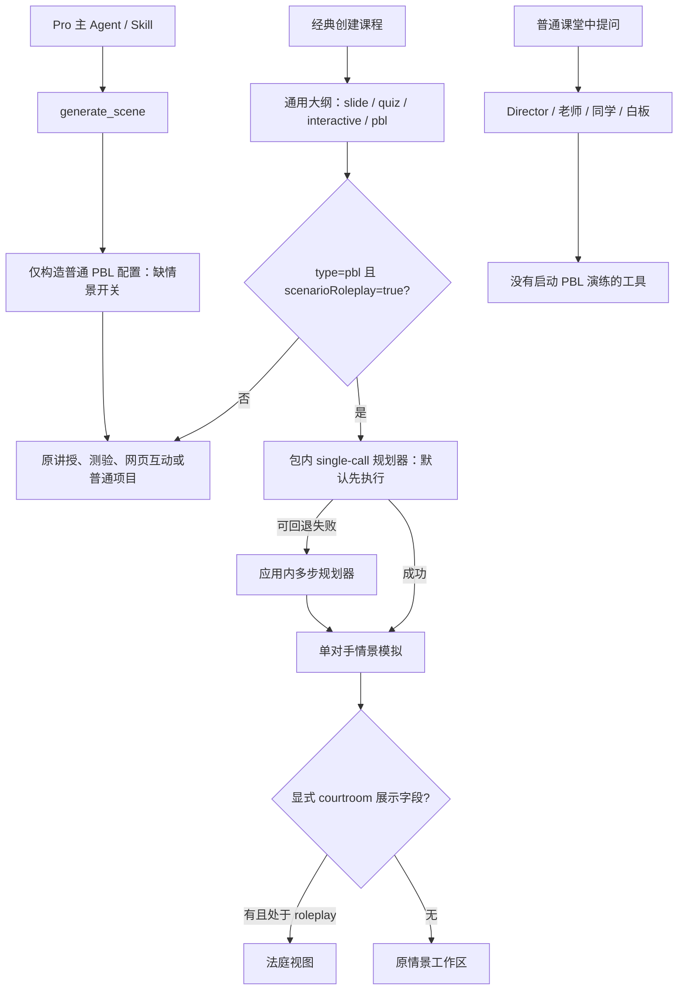

# 法考学习方向：模拟法庭调用与架构审查

审查日期：2026-11-16。对象为当时的 MAIC 工作树（基线 1367289 加既有未提交改动）。本文替代 2026-10-30 的架构建议；旧版本由 Git 历史追溯。产品目标群体已由用户明确为法考学生。

**2026-11-19 状态更新：** 下文保留修复前证据，“当前”和“本轮”均指 11 月 16 日的审查。此后已接通短练 Skill、Pro 参数、两种规划的展示字段、Pi 问答推荐、共同案卷和专用评价。现行范围见[实现设计](legal-learning-implementation-design.md)，操作见[试用说明](courtroom-preview-and-tryout.md)，剩余工作见[制作计划](../制作计划.md)。

## 1. 结论

1. **知识点需求到法庭脚本没有接通。** 仓库内置 Skill 中没有模拟法庭脚本，经典生成、Pro 制作和普通课堂问答还存在不同的配置或工具缺口。用户观察有结构原因，不能主要归结为模型不愿调用。
2. **当前是单对手情景模拟加法庭视图。** 它有阶段、导师、对话、进度保存和复盘基础，经过压缩后可以承载单争点短练；目前既没有面向短练的成本设计，也没有完整多角色庭审能力。
3. **优先解决教学与内容一致性。** 材料、规则、学习目标和评价并未形成同源合同。扩大调用会放大这些问题；法庭出现次数不能代替学习效果。
4. **不沿用“先完成整场庭审，再考虑课程衔接”的开发顺序。** 建议先把一个知识点从解释、短练、独立作答到反馈跑通，再决定完整庭审的投入。
5. **不默认历史架构正确。** 单独新建 TrialSession 状态机、多 Agent、私有证据、向量库或 MCP 均不是法考短练的前置条件。先复用现有运行记录，只有出现实际职责差异时再扩展。

## 2. 当前调用链与断点

### 2.1 三种入口需要分别审查

这里存在四个不同概念：选择学习活动、生成情景内容、运行角色对话、选择法庭外观。显示了法庭，不代表加载了法学脚本；生成了情景，也不代表采用了法考评价。

### 2.2 已确认的证据

行号为本次审查的源码位置，后续修改可能移动。

| 编号 | 当前事实                                                                                          | 源码证据                                                                                                                              |
| ---- | ------------------------------------------------------------------------------------------------- | ------------------------------------------------------------------------------------------------------------------------------------- |
| E01  | 默认 Skill 目录为 skills/agent-runtime；实际发现 24 个内置 Skill，没有法庭候选                    | lib/server/agent-runtime/config.ts:44；skills.ts:230、465；诊断探针                                                                   |
| E02  | 文档案例没有运行时注册入口；Skill 被主 Agent 读取也不会自动向子调用传递                           | lib/server/agent-runtime/skills.ts:779 的 skillOutlineContext 没有生产调用者；generation-tools.ts:518 的 activeSkill 用于生成后的检查 |
| E03  | Pro generate_scene schema 没有 pblConfig、scenarioRoleplay、scenarioBrief；构造配置也未补这些字段 | lib/server/agent-runtime/generation-tools.ts:39、317、374                                                                             |
| E04  | 经典大纲允许显式情景配置，并能保留该开关，但没有法考知识点或错因驱动的活动选择                    | lib/server/generation/outline-schema.ts:166；packages/@openmaic/generation/templates/requirements-to-outlines/system.md:201           |
| E05  | 通用大纲要求 PBL 为长、综合、多步骤活动，每课最多一个，不用于简单练习                             | 同一大纲模板:212；情景配置说明:220                                                                                                    |
| E06  | 默认先走包内 single-call，应用内多步 Planner 主要作为特定失败后的回退                             | packages/@openmaic/generation/src/scene-generator.ts:1116、1139；lib/server/generation/steps/scene-content.ts:318                     |
| E07  | 只有多步 set_scenario 支持 presentation；single-call 输出形状和 hydration 均没有该字段            | lib/pbl/v2/agents/planner.ts:585、654；packages/@openmaic/generation/src/pbl/planner-single-call.ts:106、449                          |
| E08  | 法庭是显式展示偏好，要求已有 scenario 且正处于 roleplay；切换外观不会加载脚本                     | components/scene-renderers/pbl/v2/courtroom-state.ts:15                                                                               |
| E09  | 普通课堂 Director 只有读取场景、调用角色、结束和交还发言等工具；子调用也没有启动 PBL 的工具       | lib/chat/pi/director-loop.ts:138；tools/classroom-actions.ts:270；tools/call-agent.ts:746                                             |
| E10  | 普通课堂 read_scene 不暴露 PBL 正文，不能据大纲标题推断老师理解整场演练记录                       | lib/chat/pi/tools/read-scene.ts:120                                                                                                   |

E01 仅证明仓库默认内置目录的情况。本轮未读取用户数据库里的自建 Skill，也未验证部署时自定义 OPENMAIC_AGENT_SKILLS_DIR。E03、E07、E09 是独立问题，即使另有自建 Skill，也不会自动消失。

## 3. 当前架构的主要问题

### 3.1 高优先级：调用合同断开，且没有可解释的活动选择

“这个知识点适合讨论”不能独自决定进入法庭。系统还需要知道学生的困难、是否需要独立作答、可用时间、是否有合适材料。现有链路没有共同承担这一职责的模块，而是把选择散在通用大纲、Pro 工具和用户手工编辑里。

建议集中活动选择与规格传递。经典生成和 Pro 是两个实际调用方，值得在同一 seam 验证；普通课堂问答另需推荐与启动能力，不能假装修好生成入口就覆盖它。选择依据应可供调试检查，包括选择了什么、为什么、材料是否可用、为何降级；学生只需要看到目标、时长和开始入口。

只新增 Skill 或标题关键词判断会使问题更隐蔽：主 Agent 看似遵守要求，下游仍可能生成普通 PBL；不同入口继续漂移。修改位置要覆盖包内默认实现，而不只是应用内回退代码。

### 3.2 高优先级：学生与 AI 不保证依据同一份材料

法庭视图会汇总阶段 documents（courtroom-state.ts:29），但 Simulator 的提示构造只读取情景设定、规则、当前简报、任务与角色（lib/pbl/v2/agents/simulator.ts:125）；最终评价输入也没有共同材料原文、固定法律依据或法考参考答案（lib/pbl/v2/operations/runtime/eval-prompts.ts:445）。

相关事实可能已被重复写进简报，因而不能断言模型每次都缺少案情。真正的问题是没有同源保证：修改合同原文后，对手和评价仍可能依据另一份摘要。

建议先形成固定的共同案情、材料引用和规则依据，再分别生成学生可见内容、对手上下文和评价输入。短练先用共同材料即可。不要先建设角色密卷，再补最基本的内容一致性。对手发言是立场表达，不能自动变成事实或正确法律解释。

### 3.3 高优先级：通用情景评价与法考目标冲突

当前 evaluator-final-scenario.md:1、105 明确强调互动技能并禁止谈 concepts；:59 的星级主要评价互动表现，不确定时默认 4 星。Instructor 在 wrapup 阶段明确禁止追问、答题或新任务（instructor.ts:788）。这些规定适合原来的互动练习，但不能据此判断法考知识掌握。

建议为法律练习补充相应评价依据：识别了哪个问题、采用什么规则、如何结合事实、遗漏了什么，最后能否独立写出答案。互动表达可以保留为辅助反馈。扩展必须按活动语义生效，不能全局改掉其他情景的原有规则。

“完成”也不能表示“掌握”：completeRoleplayAct 允许本幕至少一条学生发言后结束，并把其余 beat 标 completed（packages/@openmaic/generation/src/pbl/operations/kernel/progress.ts:667）。这是合理的退出机制，但下游应分别理解做过、独立完成、提示后完成和未观察到。

### 3.4 中优先级：短练的阅读与模型调用开销过重

现有情景至少包含 prep、roleplay、wrapup（planner-single-call.ts:275）。准备开场要求丰富的八项说明（instructor.ts:737），通常每轮角色回复后还会调用一次旁白（simulator.ts:297、535、614）。把预计时长改成三分钟，实际等待与阅读不会随之缩短。

建议短练采用很短的案情、一个争点、少量回合和直接反馈；旁白按实际教学需要使用。设置可用时间和轮次预算，并测量首个可作答时刻、每轮耗时、独立作答耗时。预算过小或材料不足时提供普通案例题，不为展示法庭额外填充环节。

### 3.5 中优先级：法庭图像会夸大多角色能力

Planner 要求恰好一个对手，single-call 还会裁掉额外角色（planner-core.ts:206；planner-single-call.ts:325）。Simulator 固定选择 characters[0]（simulator.ts:70）。审判席、书记员席和当前发言高亮并不代表已有法官调度或笔录业务。

短练只需要一个稳定对手。完整庭审才可能需要法官、证人、程序分支和证据披露；这些不能只靠增加角色数组或换头像完成。当前按原告/被告及角色文本猜立场的视图，也不足以直接覆盖刑事和行政场景。

### 3.6 中优先级：已有运行记录，不宜再造第二份进度权威

PBL 已有 RuntimeStore、学习者分区、事件折叠、快照与重练 epoch（lib/pbl/v2/runtime/hydration.ts:192；drain.ts:151；fold.ts:368）。接口仍接收整个 project 并执行无状态变换，不等于已实现历史文档中的庭审专用命令修订服务。

建议先深化现有 runtime 的保存、恢复和幂等能力。若新增 TrialSession，必须明确其取代还是投影于 PBL 状态；并行维护两份阶段、发言和完成状态会让刷新、重练、重试、权限与迁移形成成倍组合。后台保留事件，也不代表已有面向用户的历次练习比较功能。

完整演练还面临证据截断：Simulator 最多取 300 条历史；最终评价只取末尾 6000 字符，却评全部阶段目标（eval-prompts.ts:411、436、467）。应保存可引用的阶段证据或明确“未观察到”，不应只扩大上下文窗口。

## 4. 更适合短时演练，还是完整演练

| 维度     | 当前实现                                                   | 短时单争点练习需要补充             | 完整庭审额外需要           |
| -------- | ---------------------------------------------------------- | ---------------------------------- | -------------------------- |
| 活动选择 | 通用大纲或手选                                             | 按学习困难、目标与时间推荐         | 综合任务与先修要求         |
| 角色     | 一个对手；导师主要用于准备与复盘，演练中独立提示入口未接通 | 对手、导师职责清楚，补实际提示入口 | 实际多角色调度与角色身份   |
| 流程     | 准备—演练—复盘                                             | 压缩开场、少量回合、可跳过         | 程序模板、分支与允许动作   |
| 材料     | 可显示，AI 未保证同源                                      | 固定小案情和共同依据               | 更多材料、披露及证据状态   |
| 评价     | 互动技能与星级                                             | 法律推理、独立答案、变式检查       | 分阶段证据、综合论证评价   |
| 保存     | 已有 PBL runtime                                           | 可靠恢复、练习次数与提示记录       | 长会话一致性与完整审计     |
| 成本     | 角色回复加旁白等调用                                       | 限制等待与不必要调用               | 长上下文、多角色及更多维护 |
| 导出     | PBL 简报投影                                               | 明确在线继续入口                   | 不把静态简报称为可交互庭审 |

**判断：现有外壳更容易改造成短练，但它目前没有完成这项适配；完整庭审仍是另一阶段的工程与内容投入。** 六幕合同样例是较长的教学演练底稿，也不是法律程序意义上的完整庭审。

## 5. 值得深化的模块与备选路线

以下只是职责建议，不在本轮确定新的类型签名或大型通用框架。Module 表示具有 interface 与 implementation 的职责集合；seam 是可替换行为的位置，adapter 是其具体实现。目标是用 depth 同时获得调用方的 leverage 和维护时的 locality。

| 候选                      | 问题与建议                                                                                      | 推荐强度        | 对照与复杂度控制                                                                |
| ------------------------- | ----------------------------------------------------------------------------------------------- | --------------- | ------------------------------------------------------------------------------- |
| 活动选择与传递 module     | 当前选择散在大纲、Pro、手工编辑；集中选择理由与规格传递，在经典/Pro 两个 adapter 处验证同一合同 | Strong          | 先修已有两个入口。课堂临时练习单独定义启动行为，避免直接给所有老师开放课程编辑  |
| 案情与评价依据 module     | 材料展示、角色摘要、评分各自拼接；由同一固定底稿投影各自需要的上下文                            | Strong          | 先共同材料和短练。角色私有信息、法律检索体系按需要增加                          |
| 练习结果与反馈 module     | Quiz 分数、PBL 星级、结课正确率代表不同东西；关联考点、作答证据、提示和后续复习                 | Strong          | 先支持几种明确结果，不急于一个总掌握分或全学科知识图谱                          |
| 独立完整庭审运行 module   | 历史建议新增大量庭审状态和角色                                                                  | Worth exploring | 有真实综合训练需求后再做。删除现有 runtime 后若复杂度只是转移，就不值得再造一套 |
| 通用自治多 Agent 庭审平台 | 尚无用户需求和学习收益证据支撑                                                                  | Speculative     | 不作为当前法考产品主线                                                          |

对短练有三种路线需要比较：

- **直接压缩现有 PBL：** 复用保存和工作区最省事，但需有针对性的开场、评价和调用预算，不能全局改变普通 PBL 的“综合项目”语义。
- **直接在普通聊天里演练：** 启动最轻，但若不保存题面、独立作答和反馈，容易变成一次无法复查的对话。
- **为课堂临时练习补最小运行能力：** 可以保留题面和结果、回到提问位置；代价是新增启动与恢复行为。建议先做一条真实场景验证其价值，再确定与 PBL 共用哪些实现。

不预设新 SceneType。新增类型会影响共享 DSL、验证、编辑、复制、导入导出、独立播放器和旧课程；只扩展 pbl 也并非零成本，稳定语义仍需纳入共享合同。

## 6. 法考生可能更需要解决的问题

以下来自考试任务和当前实现的推演，尚未完成用户访谈。法考有客观题及案例分析、法律文书、论述等主观题，考试结构可核对[2026 年官方公告](https://sfj.nanjing.gov.cn/njssfj/202606/t20260607_5853231.html)。这只能支持训练目标选择，不能证明模拟法庭提高通过率。

| 可能的使用场景                     | 更直接的产品能力                           | 相对法庭的优先理由           |
| ---------------------------------- | ------------------------------------------ | ---------------------------- |
| “这两个概念为什么总混？”           | 对比案例、改变关键事实后再判断             | 先暴露概念边界，无需整场庭审 |
| “解析看懂了，换题不会。”           | 隐藏解析后的独立作答、变式复测             | 验证迁移，避免把读懂当掌握   |
| “主观题有结论，写不出理由。”       | 分步形成规则—事实—结论，指出遗漏           | 直接对应书面作答目标         |
| “同一个点总错，但不知道错在哪里。” | 将错因关联到考点、原答案和复习任务         | 形成下一次学习的依据         |
| “老师、题目和 AI 对手说法不同。”   | 可定位的资料与适用时间、清楚区分立场与解释 | 一致性是新增互动的基础       |
| “只有几分钟，想补一个薄弱点。”     | 直接练习入口和时间预算                     | 不必先生成整课或读长简报     |
| “想检验综合材料和反驳能力。”       | 可选完整专题演练                           | 此时法庭的组织方式更有价值   |

当前已有能力也要准确保留：

- Quiz 作答和反馈已进入 RuntimeStore，并非没有学习记录。
- 前置 Quiz 会按整场准确率调整 PBL proficiency（lib/pbl/v2/operations/runtime/quiz-snapshot.ts:42）；课堂对话也能读取当前题结果（lib/chat/quiz-results-for-store-state.ts:49）。简答 AI 得分会在 QuizView:123 按 80% 阈值转为正确/错误，这种二值信号不能保留完整的论证质量和评分不确定性。
- 缺少的是稳定考点、错因、跨活动证据及跨课程复习联系。不同知识点的总正确率直接迁移到任意 PBL，可能错误调整难度。
- 题库当前按 topic、tags、题型、难度与文本包含匹配，没有知识点 ID、法域或适用时间硬约束（lib/legal/questions.ts:46；assessment-service.ts:30）。
- 编辑是同 ID 更新并带乐观并发控制；旧课程有内容快照，但没有独立 QuestionVersion 实体。不得将“旧课程内容不变”写成已经具备完整题目版本管理。
- 简答评分仅收到题面、作答、分值及可选 commentPrompt，没有按可信题目版本读取标准答案或法律依据（app/api/quiz-grade/route.ts:15、55；QuizView:103）。
- 结课汇总重新判选择题，不读取已保存的简答评分（lib/classroom/complete-summary.ts:73）。它可以展示客观题表现，不能当综合法考能力概览。
- 现有空库补题提高可用性，但题目、解释、对手和评价若都来自未经独立核对的模型输出，可能相互强化同一错误；格式合法或同一模型重复赞同，不是法律正确性的证据。
- 当前独立练习会创建一份正常课程（app/api/question-bank/practice/route.ts:63），缺题搜索有 15 秒超时预算后再生成（assessment-service.ts:45）。这些是实现安排与上限，不是实测延迟；对几分钟短练，应先验证是否需要整课生成，以及何时能开始首次作答。
- 题库按用户隔离、初始无预置内容，意味着每个法考生可能重复积累基础题、承担生成成本。值得比较“有限的公共基础内容加用户私有资料”与“每人空库”；这是产品候选，需要一并评估内容权利、更新责任、资料隔离和来源优先级，不是立即建设公共大题库的决定。

## 7. 二阶、三阶影响

| 调整                     | 直接效果             | 二阶影响                             | 三阶影响与控制办法                                                                   |
| ------------------------ | -------------------- | ------------------------------------ | ------------------------------------------------------------------------------------ |
| 增加主动演练推荐         | 更多知识点能进入练习 | 学生可能频繁被打断，直接提问也被拉长 | 形成绕开练习的行为；先回答核心问题、展示目标和时长、允许跳过，记录拒绝后避免反复推荐 |
| 把短练塞进通用 PBL       | 复用工作区和保存     | 原“每课一个综合项目”的假设被打破     | 大纲、完成率、难度和导出语义漂移；用明确活动语义做局部适配，保留普通 PBL 回归        |
| 在课堂中自动创建演练     | 提问后立即可练       | 学习者行为开始涉及课程写入与权限     | 污染共享课程、重复场景及恢复复杂；区分作者创建场景与学习者临时练习，不扩散编辑权限   |
| 复用原星级和 completed   | 很快有漂亮反馈       | 学生将表达顺畅、点击完成当掌握       | 推荐系统继续跳过薄弱点；分开进度、互动表现、法律推理和独立作答证据                   |
| 增加导师提示             | 学生更容易完成       | 提示依赖与答案暴露上升               | 熟练度虚高，后续难度失配；保留提示使用记录，并用新题独立检查                         |
| 更多即生成题与案例       | 覆盖迅速扩大         | 各模块出现不同事实或法律结论         | 错误进入复习与长期画像；同源资料、明确生成来源和适用时间，支持定位修订               |
| 新建庭审服务及多角色     | 能表达更复杂程序     | 状态、上下文、模型调用与权限增多     | 长期维护从一个交互原型变成程序系统；先复用现有 runtime，只有真实流程要求时再拆分     |
| 全量保留长对话并用于评价 | 看起来记录充分       | 模型仍因预算截断早期内容             | 错评早期表现、成本持续上涨；保存阶段证据索引，缺证据时不作掌握判断                   |
| 自动适应学生水平         | 个性化更明显         | 异质分数被误当同一能力               | 错误推荐形成反馈循环；先关联相同考点和证据类型，保留“未知”                           |
| 引入稳定考点与资料版本   | 内容和反馈更容易关联 | 需要持续维护别名、修订和适用范围     | 内容运营成为长期成本；先做有限考点、向后兼容旧自由文本，不先建设全学科本体           |

法律可信度目前仍按原决策采用提示词方案，没有强制独立审核关卡。本次建议补资料与结果的可追溯性，并指出提示词方案的能力上限；没有擅自把人工审核改成所有练习的必经步骤。

## 8. 建议实施顺序与验证

### A. 先证明一条正确的最小链路

选择少量明确考点和固定教学材料，覆盖概念混淆、错题解释、主观题表达三类需求。样例数量是试点规模，不是成功指标。

1. 补齐活动选择、参数和脚本传递，首先打通经典和 Pro；验证默认 single-call 与回退规划器得到同一语义。
2. 确保学生、对手、导师和评价依据同一底稿。对手只负责对抗，导师与评价承担解释职责。
3. 完成一个单争点短练：进入、作答、少量反驳、独立答案、反馈、返回。先保证这条链路，再扩展角色数量。
4. 对普通课堂问答单独验证推荐与启动、暂停与返回，避免把作者工具直接暴露给学习者。
5. 将练习结果关联原问题或考点；展示下一步建议，不强行折成一个总分。

### B. 必需的测试面

- **确定性合同测试：** 三类入口的能力边界；显式情景配置传递；两种 Planner 字段一致；脚本进入应接收它的调用。
- **内容一致性：** 故意只修改材料中的日期或金额，确认对手和评价使用相同版本；未知事实不得被当作底稿。
- **运行恢复：** 刷新、重试、提前结束、重练和旧课程恢复；一次提交不会重复记录。
- **评价适配：** 法律练习能指出规则与事实适用问题；普通谈判、面试等情景保留原评价。
- **真实模型评估：** 在明确模型、提示词与时间预算下测试一组知识点需求，记录推荐理由、错误推荐、漏推荐与耗时。不要用“看到法律关键词就必须开庭”的断言代替评估。
- **学习价值验证：** 比较普通解释与短练后新题的独立作答和用时；再做延迟复测。完成率、聊天轮数、满意度只能作为辅助指标。

### C. 完整庭审的进入条件

只有在短练使用与收益得到证据、出现明确综合训练需求后，再评估多角色、程序模板、私有材料与长会话控制。正式考试、成绩认证、多人在线或跨平台 MCP 不是本轮确定范围。

## 9. 本轮验证与知识同步状态

### 9.1 验证结果

- 只读临时诊断探针连续运行，三项结果稳定：24 个内置 Skill 无法庭候选；Pro 缺情景配置且 activeSkill 正文未传给内层；显式情景成功生成后 single-call 仍不保存法庭展示字段。
- 探针“3/3 通过”表示成功证实缺口，**不表示功能修复**。只使用脚本化 AI callback 和内存 store，没有真实模型请求或数据库写入。
- 定向 PBL 运行/评价/保存测试：7 文件、138 测试通过。
- 生成、法庭展示、Pro 工具定向测试：3 文件、35 测试通过。
- 题库选题、简答评分和双入口：分别 9、5、2 测试通过。双入口冷导入首次触及默认 5 秒超时，独立以 15 秒预算重跑通过。
- 本轮额外运行场景路由、法庭展示、前置 Quiz 和结课汇总：4 文件、36 测试通过。上述集合有重叠，不应相加为独立覆盖数。
- 现有测试主要保护局部合同，没有验证“普通知识点提问自然调用法庭脚本”的真实模型表现。
- 文档相对链接、标题锚点和 Markdown 结构单独检查；仓库默认 Prettier 忽略 Markdown，因此对五份重写文档显式指定空 ignore 文件检查格式。原项目历史解读只更新入口说明，保留正文格式。

### 9.2 事实面

| 事实面 | 状态                 | 说明                                                                        |
| ------ | -------------------- | --------------------------------------------------------------------------- |
| 代码   | verified-current     | 按当前源码与确定性探针核实；本轮未修改功能代码                              |
| 运行态 | pending              | 未重放用户的实际问题、未进行真实模型推荐率或线上验证                        |
| 文档   | changed-and-verified | 同步目标受众、接入状态、短练建议与长流程定位，并检查链接和格式              |
| 规则   | verified-current     | AGENTS.md 的 Next.js 规则与 CLAUDE.md 引用关系已核对；未新增 issue/标签流程 |
| 记忆   | out-of-scope         | 本轮未读写平台长期记忆                                                      |
| 工作区 | verified-current     | 开始时已有未提交改动，保留原改动；仅更新本轮六份文档，不做分支或数据清理    |

本轮审查使用 diagnose、improve-codebase-architecture 和 neat-freak 的相关流程。仓库没有领域词汇表、ADR 或 issue 流程配置；本次是本地诊断与文档审查，未引入与任务无关的 tracker 配置。

### 9.3 文档职责

| 文档                                                | 当前职责                                                 |
| --------------------------------------------------- | -------------------------------------------------------- |
| 本文                                                | 调用证据、架构问题、产品优先级、后续影响和验证限制       |
| [实现设计](legal-learning-implementation-design.md) | 当前实现与拟议设计分开列出；保留较长合同样例，补短练设计 |
| [制作计划](../制作计划.md)                          | 目标受众与建议开发顺序，不把建议记为已实现               |
| [试用说明](courtroom-preview-and-tryout.md)         | 手动生成情景与选择外观的方法，明确其不能验证自动脚本接入 |
| [场景素材说明](../courtroom-scene/README.md)        | 静态预览与 React 视图的职责                              |
| [原项目源码解读](openmaic-project-analysis.md)      | 保留原版历史快照，入口指向本轮现役文档                   |
