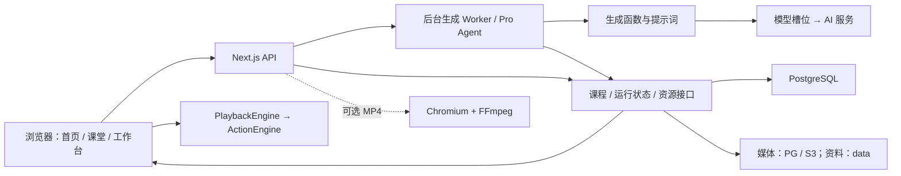
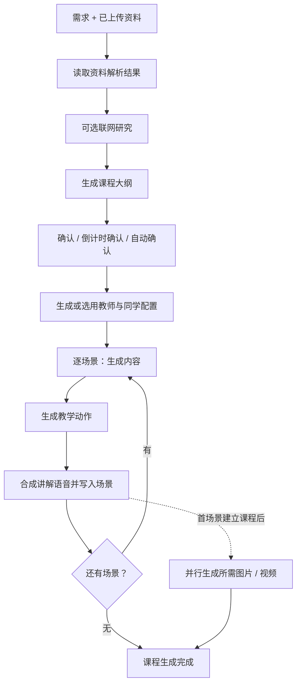

# OpenMAIC 本地源码解读

**OpenMAIC 的核心是把学习需求变成可编辑、可播放、可交互的课程，再让 AI 教师和 AI 同学围绕课程开展教学。** 课程生成、课堂播放、实时讨论、课件编辑和资源存储通过同一套课程数据契约连接起来。

本次分析日期：2026-10-08。参考源码：`D:/project/OpenMAIC-main`。分析文件：`D:/project/MAIC/docs/openmaic-project-analysis.md`。

本地 [package.json](D:/project/OpenMAIC-main/package.json:3) 标记版本为 `1.2.0-rc.1`。这是对当前本地快照的分析，不代表线上部署状态或远端最新版本。本地目录没有 `.git` 和 `node_modules`；本次只读源码、配置和测试文件，没有安装依赖、启动数据库、运行应用或执行测试。下文“已实现”指有相应代码路径，“可用”仍取决于配置、依赖和实际运行结果。

**1. 产品功能围绕一条完整的学习过程展开。** 用户输入主题、学习目标或资料，系统生成大纲与课程；进入课堂后可以听讲、做题、操作实验、提问和参与讨论；作者可以编辑课程并导出。

| 功能 | 用户看到的行为 | 源码中的实现方式与条件 |
| --- | --- | --- |
| 主题或资料生成课堂 | 输入需求，得到大纲和多页课程 | 大纲与场景分步生成；服务端持久任务执行 |
| 资料解析 | 附加文件后显示解析进度 | 上传即后台提取；按文件类型选择解析服务；完成结果缓存 |
| 幻灯片 | 文本、图片、公式、图表、音视频等 | 生成结构化 Slide JSON，由元素渲染器显示 |
| 测验 | 单选、多选、简答和反馈 | 结构化题目；客观题比对，简答调用评分接口 |
| 交互场景 | 模拟实验、思维导图、编程、游戏、3D | 按类型生成 HTML/JavaScript，在 iframe 中运行 |
| AI 讲课 | 语音、聚光灯、激光笔、白板等 | 生成并执行教学动作；语音可预生成，也有降级路径 |
| 多角色讨论 | 教师、助教和不同人设的同学发言 | 导演控制发言顺序，角色运行器产生回答与动作 |
| PBL 项目学习 | 选择角色，完成任务与里程碑 | 项目规划、指导、情境模拟、分层评价和学习进度 |
| 课件编辑 | 调整元素、页面、互动内容和讲稿 | 编辑器与课程操作 API；专业模式需要启用 |
| Pro 工作台 | 持久对话，引用课程或元素，让 Agent 制作或修改课件 | 后台 Agent 会话、工具、资料和技能；默认有功能开关 |
| 导入导出 | PPTX、HTML、课堂 ZIP 等 | 从课程结构转换；不同格式保留的交互能力不同 |
| MP4 导出 | 把课程和讲解导出为视频 | 编译时间线，调用独立渲染服务；需要开关和服务可达 |
| 多模型与多模态 | 各环节可选择不同服务 | 模型槽位配置，分别接入 LLM、TTS、ASR、图像、视频、搜索和解析 |

功能分发可从 [scene-renderer.tsx](D:/project/OpenMAIC-main/components/stage/scene-renderer.tsx:20) 查看；本地 [README-zh.md](D:/project/OpenMAIC-main/README-zh.md:592) 提供产品层面的说明。

**2. 整体架构是 TypeScript 全栈应用，加可复用 SDK 子包和可选的渲染服务。** 主体使用 Next.js，前端界面和服务端 API 在一个项目里；后台生成 Worker 也运行在 Node 服务中。它没有把课程生成主体做成独立的 Python 后端。

| 层 | 主要技术与目录 | 职责 |
| --- | --- | --- |
| 页面与交互 | Next.js App Router、React 19、Tailwind CSS 4、shadcn/Radix；`app`、`components` | 首页、生成预览、课堂、工作台、编辑与设置 |
| 浏览器状态 | Zustand；`lib/store`、`lib/workbench` | 当前课程、画布、播放、媒体状态、工作台面板等 |
| HTTP 接口 | `app/api`、`lib/server` | 输入校验、身份解析、模型解析、任务提交、事件流和存储入口 |
| 后台执行 | `lib/server/generation/run`、`lib/server/agent-runtime` | 课程生成任务与 Pro Agent 会话的执行、租约、恢复和取消 |
| 生成与智能体 | `@openmaic/generation`、Pi Agent、兼容 LangGraph 路径 | 大纲、内容、动作、角色和实时教学 |
| 数据契约 | `@openmaic/dsl` | 课程、场景、幻灯片元素、教学动作、资源引用与校验 |
| 持久化 | `@openmaic/storage`、PostgreSQL、媒体字节存储 | 课程正文、运行状态、任务、事件、资源、资料和配置 |
| 导入导出 | `lib/export`、`lib/video-export`、`render-service` | PPTX/HTML/ZIP 转换与可选视频渲染 |

本地依赖声明是 Next.js `16.3.3`、React `19.2.3`、Node.js `>=22.19.0`、pnpm `10.28.0`，见 [package.json](D:/project/OpenMAIC-main/package.json:1)。这些是项目声明值，尚未验证本机安装状态。



`pnpm-workspace.yaml` 管理 `packages/*` 与 `packages/@openmaic/*`；文档站 `packages/docs` 被显式排除，有独立构建。`render-service` 也是独立运行、按需启用的服务。默认 Docker 部署是应用和 PostgreSQL 两个容器，启用视频导出后增加渲染服务。

**3. 最重要的数据设计是将课程内容和教学行为分别保存。** `Stage` 表示课程元信息，`Scene` 表示课程中的一个页面或学习场景。场景通过 `stageId` 关联课程，具有排序、内容、教学动作和多角色配置。

`Scene.type` 有四种：`slide`、`quiz`、`interactive`、`pbl`。它们分别携带幻灯片画布、题目、互动页面和项目学习结构；类型契约约束场景类型与内容类型一致。课程元信息与场景集合由文档层组合，不要把 `Stage` 类型误读为直接内嵌所有场景的对象。

| 数据 | 保存什么 | 为什么这样划分 |
| --- | --- | --- |
| Stage / Scene / Slide | 课程设计、页面结构和元素 | 生成、编辑、渲染、导出使用同一份内容 |
| Action | 讲稿、聚光灯、白板、视频、讨论、互动操作 | 内容可以重复播放，也可以被实时教学执行 |
| Runtime | 学习进度、讨论记录、测验和 PBL 学习状态等 | 学生使用课程的状态与课程设计分开 |
| Asset / AssetRef | 媒体资源及引用关系 | 课程只需引用资源，资源池负责字节、归属和回收 |
| GenerationRun / AgentSession | 生成或 Agent 执行过程 | 支持进度跟踪、后台执行、断线后读取与失败恢复 |

例如，下列是合法动作形状的简化示例，先让图示获得聚光灯，再讲解：

```json
[
  { "id": "a1", "type": "spotlight", "elementId": "diagram_1" },
  { "id": "a2", "type": "speech", "text": "观察图中输入与输出的关系。" }
]
```

生成、播放、编辑和导出因而可以围绕结构化数据协作。幻灯片并非只能作为整页图片保存；它保留文本、形状、坐标、样式、资源和元素 ID，所以能够编辑、定位和转换为 PPTX。

代码入口：[课程与场景契约](D:/project/OpenMAIC-main/packages/@openmaic/dsl/src/stage.ts:141)、[场景公共字段](D:/project/OpenMAIC-main/packages/@openmaic/dsl/src/stage.ts:228)、[动作契约](D:/project/OpenMAIC-main/packages/@openmaic/dsl/src/action.ts:47)、[应用扩展类型](D:/project/OpenMAIC-main/lib/types/stage.ts:1)。

**4. 经典课程生成是一个服务端执行、分步提交的流程。** 用户界面负责上传资料、提交需求、展示进度与发送确认命令，Worker 负责实际执行生成步骤。



这张图表示逻辑顺序。源码还支持在有限并发下提前生成后续场景内容，再按课程顺序消费；不是所有操作都严格串行，也不是整门课完全无约束并发。

实现过程可以分成以下步骤：

1. **上传与解析。** `POST /api/materials` 保存资料并启动后台解析。资料状态经过 `idle → extracting → ready / failed`。解析器按 MIME 与服务能力选择：TXT/Markdown 有纯文本实现，PDF 有 unpdf 和 MinerU 等实现，其他办公文档格式依赖相应解析服务支持。图片、音视频另有提取路径。支持列表不等于所有解析器都支持所有格式。
2. **复用解析结果。** 相同所有者再次上传相同字节，并使用相同解析服务配置时，可以复用已完成结果。资料文本和图片形成文档包，控制输入预算，保留来源信息；课程使用的图片复制成课程资源，避免课程随临时资料删除而丢失媒体。
3. **可选研究。** 有搜索能力时，利用需求和资料节选改写搜索查询，检索结果整理成大纲生成上下文。
4. **生成大纲。** 大纲决定课程标题、语言、各页类型、知识点、互动配置和媒体需求。它既供用户审阅，也供后续步骤使用，减少每个页面独立生成导致的脱节。
5. **确认大纲。** 后端支持 `wait`、`countdown`、`auto`。确认提交带大纲版本与命令 ID；倒计时在服务端推进，页面关闭不再让课程停在这里。编辑时可发送 `hold-outline` 将其保持在审阅状态。
6. **配置角色。** 可生成适合课程的角色，也可选预设或用户角色。配置包含姓名、角色、人设、头像、颜色、优先级以及可选音色；生成失败有预设回退。
7. **生成场景内容。** 根据 `outline.type` 分支调用 slide、quiz、interactive 或 PBL 生成逻辑。幻灯片输出可编辑 JSON；互动场景根据 simulation、diagram、code、game、visualization3d 等类型选择不同提示词。
8. **生成教学动作。** 内容已经确定后再生成讲解与动作，输入包括当前页面、整课大纲、前面场景的讲稿、角色和学习者背景，从而使讲解能对应页面元素并保持上下文连续。
9. **合成语音与提交。** 为 speech 动作合成语音；首个完成场景建立课程，后续场景陆续追加。步骤结果、状态变化和事件通过持久化提交，结束时标记课程完成。
10. **生成媒体。** 图片和视频在课程存在后沿独立媒体路径执行，按项目保存结果。单个媒体失败有自己的状态与重试路径，不必让整门课程暂停；视频恢复可利用已记录的服务商任务信息。

生成提示词按内容与动作类型拆分为独立模板，位于 `packages/@openmaic/generation/templates`，配合 snippets 统一 JSON、媒体引用、语言和讲稿约束。输出有 JSON 修复、结构检查、元素规范化和互动脚本检查，不能只把模型返回的文本直接视为成功课程。

代码入口：[步骤计划](D:/project/OpenMAIC-main/lib/server/generation/run/plan.ts:46)、[执行引擎](D:/project/OpenMAIC-main/lib/server/generation/run/engine.ts:366)、[场景内容生成](D:/project/OpenMAIC-main/packages/@openmaic/generation/src/scene-generator.ts:228)、[场景动作步骤](D:/project/OpenMAIC-main/lib/server/generation/steps/scene-actions.ts:1)、[资料解析](D:/project/OpenMAIC-main/lib/server/materials/extraction.ts:1)、[生成提示词种类](D:/project/OpenMAIC-main/packages/@openmaic/generation/src/prompts/types.ts:6)。

在本次追踪的经典流水线里，资料主要以受预算约束的文本和图片进入生成上下文。`lib/rag` 另有切块、检索接口与内存词法索引；没有证据表明这条主流程必须依赖已部署的向量数据库。

**5. 后台任务可靠性依靠 PostgreSQL 中的状态、租约、检查点和事件。** 这是本地 1.2.0 快照相较于旧版浏览器驱动流程的重要变化。

生成任务有 `preparing → outlining → awaiting_outline_confirmation → generating → completed`，以及 `paused` 和 `ended`。达到重试上限的步骤暂停；删除课程或丢弃任务会结束执行。等待大纲与暂停状态不占用执行 Worker。

Worker 领取任务时使用行锁与 `FOR UPDATE SKIP LOCKED`，写入租约并持续心跳。租约失效后其他进程可以接管；租约代数限制旧 Worker 继续提交。每个完成步骤写入检查点，下一次执行从已提交进度恢复，失败重试针对具体步骤。

检查点、状态更新、事件序号写在同一事务里，浏览器通过 SSE 读取有序事件日志。SSE 支持按序号续读、心跳与重同步；数据库通知负责唤醒，轮询负责补偿通知丢失。关闭浏览器会关闭事件订阅，后台执行仍可继续。服务器重启期间执行会暂时停止，重启或其他进程接管后恢复；不要理解成机器断电期间仍然运行。

默认配置允许一个进程执行 4 个生成任务，每个所有者同时执行 2 个任务，并限制等待确认的任务数。并发与配额都有环境配置入口。

这套任务系统内嵌于应用进程和 PostgreSQL，未要求额外部署 Redis/Celery 队列。启动钩子 `instrumentation.ts` 启动生成 Runner、资料提取器等；只有启用 Agent Runtime 时才启动 Pro Agent Runner。

代码入口：[状态与输入](D:/project/OpenMAIC-main/lib/server/generation/run/types.ts:23)、[领取任务](D:/project/OpenMAIC-main/lib/server/generation/run/store.ts:814)、[原子提交](D:/project/OpenMAIC-main/lib/server/generation/run/store.ts:1074)、[SSE](D:/project/OpenMAIC-main/lib/server/generation/run/sse.ts:1)、[并发配置](D:/project/OpenMAIC-main/lib/server/generation/run/config.ts:54)、[进程启动](D:/project/OpenMAIC-main/instrumentation.ts:1)。

**6. 课堂播放把预生成教学动作和实时交互接在一起。** `/classroom/[id]` 与工作台中的课堂面板共用 `ClassroomSurface`，后者加载课程、资源和生成状态，再交给 Stage 与各类场景渲染器。

`PlaybackEngine` 保存场景位置、动作位置、已消费的讨论触发点和当前模式，模式包括 `idle`、`playing`、`paused`、`live`。它直接消费 `Scene.actions`，通过 `ActionEngine` 执行。用户插话或确认讨论时，保存讲课位置，进入 live 讨论；讨论结束后可恢复原来的播放位置。

动作引擎统一处理 speech、spotlight、laser、白板、视频与 widget 操作。聚光灯、激光笔可以立即发出；语音、白板等需要等待对应过程。播放、暂停、倍速、恢复、异步结束回调都围绕同一游标和状态运行，避免音频结束与用户切页相互冲突。

AI 白板通过结构化动作添加文字、图形、图表、公式、表格、线条和代码块；这些动作最终改变画布内容。互动页面在 sandbox iframe 中执行，宿主通过消息桥发送高亮、设置变量等指令，也读取允许的交互观察信息。iframe 由稳定宿主管理，避免切换编辑模式或场景时无谓重载、丢失实验状态；内容变化则可重新加载。

代码入口：[共用课堂界面](D:/project/OpenMAIC-main/components/classroom/ClassroomSurface.tsx:1)、[播放引擎](D:/project/OpenMAIC-main/lib/playback/engine.ts:57)、[动作引擎](D:/project/OpenMAIC-main/lib/action/engine.ts:214)、[互动 iframe](D:/project/OpenMAIC-main/components/scene-renderers/InteractiveIframeHost.tsx:437)。

**7. 多智能体需要分清三个执行场景，默认课堂路径已经使用 Pi Director。** 仅根据 README 中的 LangGraph 标签判断当前实现会遗漏新路径。

| 场景 | 执行模型 | 生命周期与状态 |
| --- | --- | --- |
| 经典课程生成 | 固定步骤计划与后台 Worker | GenerationRun 保存检查点、状态和事件，脱离浏览器执行 |
| 课堂实时讨论 | 默认 Pi Director 循环，通过 SSE 返回 | 请求传入课程/对话快照；这条链路本身不能直接等同于 Pro 的持久后台会话 |
| Pro 创作工作台 | Pi Agent + 工具 + 后台 Runner | AgentSession 持久保存会话、消息、条目、事件、租约和取消状态 |

默认 `POST /api/chat/pi` 创建一个导演 Agent。导演读取当前场景证据，再用 `call_agent` 派发角色发言，或使用 `cue_user` 将发言权交回用户、`close_session` 结束一轮讨论。角色回答时根据人设、课程内容、讨论历史和白板状态生成文本与动作。导演有发言轮次、工具次数和动作数量边界。

默认 Pi Director 中，角色执行仍可使用旧的 JSON 动作生成方式；Native Child 是另一项默认关闭的服务端开关。因此“导演已迁移 Pi”不等于每个角色都默认运行完整原生工具循环。

旧的 `POST /api/chat` 与 `lib/orchestration/director-graph.ts` 保留 LangGraph 实现。该图一次请求最多执行一轮 director → agent，连续讨论由客户端多次请求推进；关闭 Pi 开关并重新构建可走兼容路径。

Pro 工作台则让 Agent 调用课程创建/读取/编辑、场景生成、资料读取、媒体和 TTS、角色设置、搜索、技能等工具。它有持久会话和后台租约，即使 SSE 客户端断开也不决定任务寿命。课程引用与元素引用帮助 Agent 针对已有内容修改；服务端写入边界检查归属、课程状态和当前租约。

这里的 Skill 指供 Agent 按需加载的任务指南与提示词资源；它与模型、工具和持久会话配合使用。外部工作台的 OpenMAIC skill 也是另一个入口，本次只把它作为项目组成部分理解，没有执行其操作流程。

代码入口：[Pi 课堂 API](D:/project/OpenMAIC-main/app/api/chat/pi/route.ts:1)、[导演循环](D:/project/OpenMAIC-main/lib/chat/pi/director-loop.ts:138)、[Agent 工具边界](D:/project/OpenMAIC-main/lib/agent/runtime/build-agent.ts:72)、[旧 LangGraph](D:/project/OpenMAIC-main/lib/orchestration/director-graph.ts:1)、[Pro 后台 Runner](D:/project/OpenMAIC-main/lib/server/agent-runtime/runner.ts:1946)。

**8. PBL 是有结构和状态的任务学习系统。** 规划器生成角色、里程碑、微任务、情境和交付要求；Instructor 指导学习者，Simulator 参与情境模拟，Evaluator 评价任务、里程碑和最终成果。

PBL v2 的评价接口按 `task`、`milestone`、`final` 选择运行逻辑，并以 SSE 返回内容和项目 patch。部分接口采用客户端提交项目快照、服务端计算并返回修改的方式；不应把所有 PBL 路由都理解成自动后台排队任务。

PBL 的可复用项目设计与个人学习状态分离。保存课程时，将设计模板保存到文档，把学习运行状态同步到 Runtime；下次读取时再组合。这个边界有助于让不同学习者使用同一份项目设计。

职业任务引擎 `taskEngineMode` 是另一条受服务端开关控制的生成分支，也包含 `procedural-skill` 交互类型。默认关闭时回退普通生成。它是可选能力，不代表普通课堂必须具备职业训练流程。

代码入口：[PBL 评价 API](D:/project/OpenMAIC-main/app/api/pbl/v2/evaluate/route.ts:1)、[设计与学习状态分离](D:/project/OpenMAIC-main/lib/pbl/v2/runtime/document-persistence.ts:14)、[职业功能开关](D:/project/OpenMAIC-main/lib/config/feature-flags.ts:126)。

**9. 模型槽位把“教学用途”与“服务商连接”分开。** `openmaic.yml` 声明部署能调用的 providers，以及各用途使用的 slots；密钥通过环境变量引用。Web 设置则保存所有者自己的 provider 与槽位选择。

例如 `llm` 是文本能力根默认值，`course.outline` 用于大纲，`course.content.slide` 用于幻灯片内容，`course.actions` 用于教学动作，`classroom` 用于课堂问答及评分，`agent` 用于 Pro 工作台。TTS、ASR、图片、视频、搜索、文档解析各有独立能力槽位。

未赋值的子槽位沿父节点继承；显式 `null` 关闭对应能力。普通槽位先查用户工作区设置，再查服务端默认；锁定子树只采用部署配置。`allowUserKeys` 决定用户是否可以添加自己的服务商。统一 LLM 层通过 AI SDK 适配调用、流式返回、思考参数和有条件的回退。

用户在 Web 设置保存的密钥与普通配置分列保存，并使用 AES-256-GCM 加密；实例密钥来自 `OPENMAIC_SECRET_KEY` 或持久数据目录中的生成值。恢复这些设置要保留实例密钥；多实例使用同一密钥是代码明确要求。

代码入口：[槽位定义](D:/project/OpenMAIC-main/lib/config/model-slots.ts:49)、[两层配置解析](D:/project/OpenMAIC-main/lib/server/model-config/resolve-slot.ts:1)、[统一 LLM 层](D:/project/OpenMAIC-main/lib/ai/llm.ts:1)、[密钥封装](D:/project/OpenMAIC-main/lib/server/secret-box.ts:1)、[配置示例](D:/project/OpenMAIC-main/openmaic.example.yml:1)。

**10. 持久化的权威数据在服务端，浏览器负责界面状态和缓存。** 课程文档、学习状态、任务、事件、所有者资料和模型设置存入服务端存储；浏览器使用 HTTP 存储接口访问它们。

媒体资源有 PostgreSQL 资源注册表，字节默认可存 PostgreSQL，配置 S3 后使用对象存储。上传资料及解析结果另有 `MaterialByteStore`，本地实现保存于运行目录的 `data` 下。两者不能笼统等同为“所有文件都在数据库”或“所有资源都在本地文件夹”。

Dexie/IndexedDB 在当前版本承担媒体缓存、缩略图、编辑撤销历史等设备数据；老浏览器课程库有单向导入路径。浏览器清理缓存与删除服务端课程是不同动作。

请求通过所有者身份绑定课程与数据。默认可以使用匿名所有者 cookie；也有单用户、共享团队和宿主注册认证方法等接缝。源码具备归属与可扩展身份接口，但不能由此推断本地快照已经内置完整的账号、订阅、支付和 SaaS 管理后台。

与产品功能直接相关的工程边界也包括：输入与输出校验、资源配额和回收、用户指定网络地址的校验及连接固定、iframe 隔离、独立视频渲染网络、并发版本检查，以及后台写入租约检查。这些机制用于处理 AI 内容、媒体和多任务的实际执行边界。

代码入口：[服务端存储提供器](D:/project/OpenMAIC-main/lib/persistence/server-provider.ts:61)、[媒体字节存储](D:/project/OpenMAIC-main/lib/persistence/asset-byte-store.ts:1)、[资料字节存储](D:/project/OpenMAIC-main/lib/server/materials/bytes.ts:39)、[设备缓存](D:/project/OpenMAIC-main/lib/device-storage/database.ts:1)、[文档存储入口](D:/project/OpenMAIC-main/lib/document-store/store.ts:36)。

**11. 导出是对同一份课程数据的转换，不同格式具有不同能力。**

| 格式 | 实现链路 | 应理解的边界 |
| --- | --- | --- |
| PPTX | 幻灯片元素 → 定制 pptxgenjs；公式经 MathML/OMML 转换 | 可编辑课件；互动场景不等于变成 PowerPoint 中原生可运行实验 |
| HTML | 页面/播放器组装，按需内联资源 | 适合交互式内容；离线结果取决于资源是否成功获取与内联 |
| `.maic.zip` | 课程结构、资源清单与媒体打包 | 用于完整课堂备份或迁移，导入需登记资源再保存文档 |
| MP4 | Scene/Action → VideoTimeline → Hyperframes 项目 → 渲染服务 | 输出视频，不能保留学生自由操作；具体场景支持情况有诊断和占位策略 |
| PPTX 导入 | ZIP/XML 解析 → 中间结构 → Slide DSL | 尽量保留可编辑元素；复杂样式有转换差异，需要检查结果 |

视频导出将编译与渲染分开：时间线、音频时长、字幕、视觉效果、几何和资源准备先形成中间表示，Chromium 与 FFmpeg 再执行重型渲染。应用有渲染服务能力探测；只有配置地址且健康检查成功，才宣称 MP4 渲染服务可达，否则可以保留 ZIP 下载路径。

PPTX importer 有浏览器环境依赖。主应用的服务端 Agent 导入路径使用专门 Worker 与适配代码，不能只把 importer 随意导入普通 Node 进程。导入现有课件与“提取课件文本后重新生成课程”也是两个不同功能。

代码入口：[PPTX 导出](D:/project/OpenMAIC-main/lib/export/use-export-pptx.ts:1)、[课堂 ZIP](D:/project/OpenMAIC-main/lib/export/use-export-classroom.ts:348)、[视频编译器](D:/project/OpenMAIC-main/lib/video-export/compile.ts:152)、[渲染服务依赖](D:/project/OpenMAIC-main/render-service/package.json:1)、[渲染能力探测](D:/project/OpenMAIC-main/app/api/export-video/capability/route.ts:1)、[Agent 的 PPTX 导入](D:/project/OpenMAIC-main/lib/server/agent-runtime/import-pptx.ts:1)。

**12. 子包提供了可以借鉴和复用的边界，但主应用仍保留兼容代码。**

| 子包 | 作用 | 对仿项目的意义 |
| --- | --- | --- |
| `@openmaic/dsl` | 纯数据契约、校验、版本与资源清单 | 先把课程格式统一，避免生成端和前端各说各话 |
| `@openmaic/generation` | 生成函数、提示词、解析与内容组装 | 提示词与生成逻辑可脱离某个页面调用 |
| `@openmaic/renderer` | 只读幻灯片渲染组件 | 使用结构化元素构建显示能力 |
| `@openmaic/editor` | core / react / ui 三层编辑能力 | 文档事务、拖动缩放、富文本和编辑控件分开 |
| `@openmaic/importer` | PPTX 解析与转换为 Slide | 建立现有课件与课程格式之间的入口 |
| `@openmaic/storage` | Document / Runtime / KV / Asset 等存储接口与实现 | 数据访问可以换后端，业务代码围绕接口协作 |
| `pptxgenjs`、`mathml2omml` | 定制导出与公式转换 | 展示最终导出质量需要专门转换逻辑 |

编辑器依赖渲染器与 DSL，渲染器不反向依赖编辑器。生成和存储也围绕 DSL 组合。与此同时，主应用还有旧渲染器、旧讨论路径、历史数据迁移和应用专用状态，所以它是持续演进的项目，不能把目录中的每条路径都理解为同时默认启用。

实际默认值应以 [feature-flags.ts](D:/project/OpenMAIC-main/lib/config/feature-flags.ts:1) 为准：

| 能力 | 当前代码默认与条件 |
| --- | --- |
| 服务端课程持久化与经典生成 | 要求 `DATABASE_URL`；不是依赖 Pro Runtime 开关才可用 |
| Pi 课堂讨论 | 默认开启；关闭需与前端构建保持一致 |
| Pro 工作台 | 需要 `NEXT_PUBLIC_PRO_WORKBENCH_ENABLED`、`OPENMAIC_AGENT_RUNTIME_ENABLED` 和数据库 |
| 专业编辑入口 | 单独编辑开关或 Pro 工作台开启时可启用 |
| 新 SDK 播放/编辑画布替换 | 各自开关默认关闭；主应用仍可走旧画布 |
| PPTX 导入 UI | 默认关闭，有独立公开开关 |
| 视频导出 UI | 默认关闭；实际 MP4 还需要渲染服务 |
| 职业任务引擎、Native Child | 默认关闭，分别有服务端开关 |
| 课堂元素引用 | 独立开关默认关闭，不能仅以 Pi 开启判断 |

**13. 运行这份源码需要常驻 Node 服务和 PostgreSQL。** 项目提供的步骤是安装 pnpm workspace 依赖，配置环境与模型，启动数据库，再运行 `pnpm dev`；生产构建运行 `pnpm build`，然后 `pnpm start`。安装阶段会构建 SDK 子包与导入适配资源，不能把这个仓库当成只装一个前端依赖就能启动的小页面。

`instrumentation.ts` 在启动时验证配置、数据库与存储模式，按需初始化后台任务、事件通知和资源回收。Next.js 配置采用 standalone 输出，Docker 构建会把依赖和构建产物打包。资料与实例运行文件、数据库数据分别需要保留对应持久卷。

本地 README 明确区分旧版 1.1.x 与当前 1.2.0：当前生成过程依赖长于单个 HTTP 请求的进程生命期，不能照搬旧版 Vercel 部署说明。视频渲染服务另带 Chromium/FFmpeg，是可选的额外成本。

项目有 Vitest 单元/契约测试、Playwright 浏览器测试以及大纲、编排、白板、PBL 的模型评估脚本。本次只确认这些测试与配置存在，没有执行，也没有用它们证明当前安装可运行或生成质量达标。

代码入口：[构建与启动脚本](D:/project/OpenMAIC-main/package.json:9)、[Next.js 构建配置](D:/project/OpenMAIC-main/next.config.ts:1)、[Docker 部署](D:/project/OpenMAIC-main/docker-compose.yml:1)、[本地数据库](D:/project/OpenMAIC-main/docker-compose.db.yml:1)、[测试配置](D:/project/OpenMAIC-main/vitest.config.ts:1)、[浏览器测试配置](D:/project/OpenMAIC-main/playwright.config.ts:1)。

**14. 模仿时建议先建立可运行的教学闭环，再扩展完整能力。** 以下是实现建议，尚未在 `D:/project/MAIC` 创建应用代码。

1. **先定义课程协议。** 至少确定 Course/Stage、Scene、SlideContent、QuizContent、Speech/Spotlight 动作、资源引用和学习进度。生成结果与编辑结果都遵循相同协议。
2. **先支持小课程生成。** 需求 → 可审阅大纲 → 幻灯片/测验 → 讲稿 → 保存课程。设计可重试步骤与后台进度，不把流程寿命绑定到浏览器页面。
3. **建立播放与提问闭环。** 实现基本渲染、语音或文本讲解、暂停、插话、按当前页面回答、恢复讲课。初期一个 AI 教师就能验证产品核心。
4. **增加互动与多角色。** 接入 iframe 模拟实验、白板动作和导演控制的角色发言；有条件地加图像、搜索和语音识别。
5. **再扩展制作功能。** 专业编辑、PPTX、PBL、持久 Agent 工作台和 MP4 等各自有独立复杂度，按实际用途逐步加入。

如果目标是快速得到近似产品体验，基于这份源码做二次开发较直接；如果目标是理解并独立实现 AI 应用，先复刻上面前三步会更容易建立可验证结果。具体选择仍取决于后续项目目标，当前阶段无需先搬完整仓库或接齐所有服务商。

值得优先学习的是五个实现决策：**统一数据契约、内容与动作分开生成、后台分步提交、播放与讨论共享动作、课程设计与学习状态分离。** 这些决策比复刻首页布局更能决定系统能否生成、教学、编辑和恢复。

建议按这条顺序继续读源码：[DSL](D:/project/OpenMAIC-main/packages/@openmaic/dsl/src/stage.ts:22) → [生成计划](D:/project/OpenMAIC-main/lib/server/generation/run/plan.ts:46) → [生成引擎](D:/project/OpenMAIC-main/lib/server/generation/run/engine.ts:366) → [场景生成器](D:/project/OpenMAIC-main/packages/@openmaic/generation/src/scene-generator.ts:228) → [播放](D:/project/OpenMAIC-main/lib/playback/engine.ts:57) → [动作](D:/project/OpenMAIC-main/lib/action/engine.ts:214) → [Pi 讨论](D:/project/OpenMAIC-main/lib/chat/pi/director-loop.ts:29) → [Pro Runner](D:/project/OpenMAIC-main/lib/server/agent-runtime/runner.ts:1946) → [持久化](D:/project/OpenMAIC-main/lib/persistence/server-provider.ts:61)。

根目录 [LICENSE](D:/project/OpenMAIC-main/LICENSE:1) 声明 MIT；子包还带各自许可证文件。

本次交付只包含这份分析 Markdown。所有新建文件均位于 `D:/project/MAIC`，参考源码与原聊天目录未写入项目文件。
